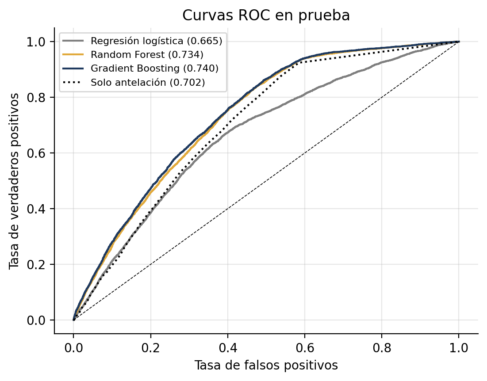
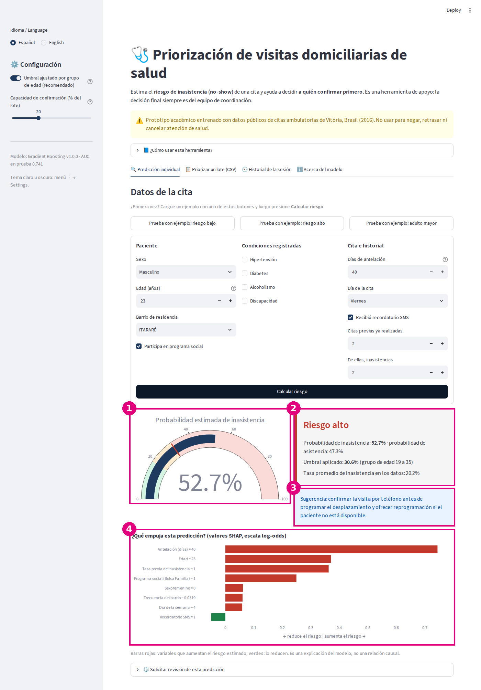
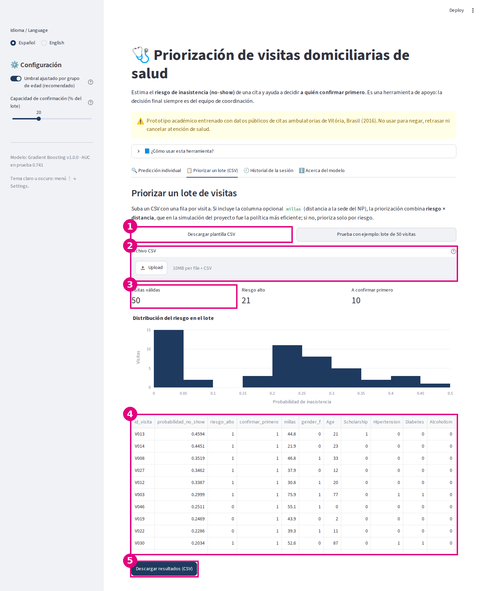

# Sistema Inteligente de Priorización de Riesgo y Asignación de Visitas Domiciliarias de Salud


**Aplicación en línea:** [priorizacion-visitas-ia.streamlit.app](https://priorizacion-visitas-ia.streamlit.app) · **Repositorio:** [github.com/roalvera/priorizacion-visitas-ia](https://github.com/roalvera/priorizacion-visitas-ia)

Sistema de IA que estima el riesgo de inasistencia (no-show) de una visita de valoración de salud y lo combina con la distancia para decidir **a quién confirmar primero**. Integra un modelo de Gradient Boosting con validación rigurosa, explicaciones SHAP, una mitigación de equidad por grupo de edad y una interfaz Streamlit lista para usar.

## Tabla de contenidos
1. [Descripción del problema](#1-descripción-del-problema)
2. [Dataset](#2-dataset)
3. [Metodología](#3-metodología)
4. [Resultados](#4-resultados)
5. [Instalación y uso](#5-instalación-y-uso)
6. [Interfaz de usuario](#6-interfaz-de-usuario)
7. [Estructura del proyecto](#7-estructura-del-proyecto)
8. [Consideraciones éticas](#8-consideraciones-éticas)
9. [Autores y contribuciones](#9-autores-y-contribuciones)
10. [Licencia](#10-licencia)
11. [Agradecimientos y referencias](#11-agradecimientos-y-referencias)
12. [Videos](#12-videos)

## 1. Descripción del problema

**¿Qué resuelve?** En los programas de valoración de salud en el hogar (IHA/HRA) de aseguradoras de EE. UU. para Medicare, Medicaid y Marketplace, una parte de las visitas no se concreta porque el paciente no está, y el personal itinerante (Nurse Practitioners) se asigna solo por cercanía. El sistema anticipa qué visitas tienen más riesgo de inasistencia y ordena las llamadas de confirmación antes de comprometer el desplazamiento.

**¿Por qué importa?** Cada visita fallida es tiempo de viaje perdido de personal clínico escaso. Menos desplazamiento inútil significa más visitas efectivas con la misma dotación y mejor cobertura de afiliados, muchos de ellos adultos mayores.

**Usuarios objetivo:** coordinadores y analistas de programación de visitas domiciliarias, y equipos de operaciones de salud que planifican rutas de personal itinerante.

## 2. Dataset

| | |
|---|---|
| Datos principales | *Medical Appointment No Shows* (Hoppen, 2016): 110,527 citas de 62,299 pacientes de la red pública de Vitória, Brasil (2016) |
| Enlace | https://www.kaggle.com/datasets/joniarroba/noshowappointments |
| Licencia | CC BY-NC-SA 4.0 (uso académico, no comercial) |
| Variables | 14 originales (sexo, edad, barrio, condiciones clínicas, SMS, fechas, no-show); 14 variables de modelo tras la ingeniería |
| Objetivo | `no_show` (20.2% de positivos) |
| Datos geográficos | Centroides ZCTA 2023 del U.S. Census Bureau (dominio público) y 15 códigos postales de NP del NPI Registry de CMS |

No se usa ningún dato real de pacientes ni de ningún empleador. El componente de asignación es una **simulación declarada** con ubicaciones públicas reales. Detalles y diccionario de variables: [`data/README.md`](data/README.md).

## 3. Metodología

- **Modelo:** `HistGradientBoostingClassifier`, elegido por validación cruzada frente a regresión logística y Random Forest. Justificación completa en [`docs/arquitectura.md`](docs/arquitectura.md).
- **Preprocesamiento:** limpieza de errores de captura; historial del paciente **sin fuga temporal** (solo citas ya atendidas al agendar); partición 75/25 **por paciente**; frecuencia de barrio calculada solo con entrenamiento. Ver [`docs/analisis_datos.md`](docs/analisis_datos.md).
- **Optimización:** rejilla con CV agrupada, análisis de sensibilidad de 68 configuraciones, ranking de importancia de hiperparámetros, dependencia parcial, interacciones (estadístico H), umbral elegido con predicciones fuera de muestra y verificación de calibración. Ver [`docs/optimizacion.md`](docs/optimizacion.md).
- **Métricas:** AUC-ROC, AUC-PR, Brier, precisión, recall y F1 con umbral explícito; AUC por subgrupo con IC bootstrap por paciente; reducción de millas desperdiciadas en una simulación de Monte Carlo (2,000 réplicas).
- **Diagnóstico de sobreajuste y subajuste (Semana 3):** tracking de métricas árbol a árbol, curvas de entrenamiento y validación, curvas por tamaño de dataset y por hiperparámetro, diagnóstico cuantitativo con umbrales explícitos y estrategias de mejora evaluadas. Ver [`notebooks/03_modelado.ipynb`](notebooks/03_modelado.ipynb) y la sección 1 de [`docs/optimizacion.md`](docs/optimizacion.md).
- **Explicabilidad y equidad:** SHAP (global y por predicción) y umbrales por grupo de edad para reducir la brecha de cobertura.

**Integración de las actividades del curso**

| Actividad | Dónde se integra en el proyecto |
|---|---|
| Planificación y definición del problema | [`docs/planificacion.md`](docs/planificacion.md) |
| Análisis exploratorio de datos | [`notebooks/01_exploracion.ipynb`](notebooks/01_exploracion.ipynb), [`docs/analisis_datos.md`](docs/analisis_datos.md) |
| Semana 3: diagnóstico de overfitting/underfitting | [`notebooks/03_modelado.ipynb`](notebooks/03_modelado.ipynb), [`src/diagnosis.py`](src/diagnosis.py), [`docs/optimizacion.md`](docs/optimizacion.md#1-diagnóstico-de-sobreajuste-y-subajuste-semana-3) |
| Workshop S5: optimización y sensibilidad de hiperparámetros | [`notebooks/04_optimizacion.ipynb`](notebooks/04_optimizacion.ipynb), [`src/optimization.py`](src/optimization.py), [`docs/optimizacion.md`](docs/optimizacion.md) |
| Evaluación, explicabilidad y equidad | [`notebooks/05_evaluacion.ipynb`](notebooks/05_evaluacion.ipynb), [`docs/consideraciones_eticas.md`](docs/consideraciones_eticas.md) |
| Despliegue con interfaz | [`app/app.py`](app/app.py), [`docs/manual_usuario.md`](docs/manual_usuario.md) |

## 4. Resultados

**Modelo (conjunto de prueba: 27,631 citas de 15,662 pacientes no vistos)**

| Modelo | AUC-ROC | AUC-PR | Brier |
|---|---|---|---|
| Sin información (prevalencia) | 0.500 | 0.202 | 0.161 |
| Referencia: solo antelación | 0.702 | 0.311 | 0.156 |
| Regresión logística | 0.665 | 0.305 | 0.154 |
| Random Forest | 0.734 | 0.366 | 0.144 |
| **Gradient Boosting final** | **0.741** | **0.377** | **0.142** |

- Validación cruzada agrupada de 5 pliegues: AUC 0.735 ± 0.003.
- Con el umbral de 0.242: exactitud (accuracy) 0.655, recall 0.710, precisión 0.334, F1 0.454. Con el umbral por defecto de 0.5 la exactitud era 0.799, pero solo porque el modelo casi nunca predecía inasistencia (recall 0.017): en un problema desbalanceado la exactitud sola es engañosa.
- Variable más influyente: la antelación de la cita, seguida de la edad (permutación y SHAP coinciden).
- **Equidad:** con un umbral único, el sistema detectaba solo el 30.6% de las inasistencias de los adultos de 65 años o más; con umbrales por grupo, el recall de todos los grupos de edad queda entre 70% y 74%. Por sexo no hay brecha (recall de 70.9% y 71.1%), y los grupos socialmente más vulnerables (Bolsa Família y barrios de vulnerabilidad alta) reciben **más** cobertura, no menos. AUC y recall con IC 95% por edad, sexo y proxies socioeconómicos en [`docs/consideraciones_eticas.md`](docs/consideraciones_eticas.md).



**Sistema completo (beneficio simulado: priorizar el 20% de 300 visitas en Ohio; supuesto de 25% menos no-show por confirmación)**

El conjunto de datos no trae distancias: las solicitudes se ubican en centroides reales de códigos postales de Ohio (Census Bureau) y las sedes en códigos postales reales de NP (NPI Registry); a cada solicitud se le asigna, en cada réplica, el riesgo y el desenlace de una cita real de prueba. Esa asociación es sintética, por lo que el resultado es simulado, no observado.

| Política | Reducción de millas desperdiciadas (IC 95%) |
|---|---|
| Al azar | 5.0% (2.5 a 7.7) |
| Solo distancia (sin modelo) | 8.9% (5.3 a 12.1) |
| Por riesgo | 9.6% (6.6 a 13.0) |
| **Riesgo × distancia** | **12.6% (9.5 a 15.7)** |
| Cota óptima (conoce el desenlace) | 24.8% (23.6 a 25.0) |

**Sensibilidad al supuesto del 25%:** con 10% de efecto, riesgo × distancia reduce 5.0% (3.9 a 6.2) y solo distancia 3.6%; con 40%, 20.0% (15.5 a 24.8) y 14.2%. El orden de las políticas no cambia, porque la reducción es proporcional al efecto supuesto. El aporte del modelo es de unos 3.7 puntos sobre la mejor política sin modelo (con 25%). **Dónde funciona peor:** dentro de un mismo tramo de antelación el AUC baja a 0.59 a 0.68 (el modelo se apoya mucho en la antelación) y en adultos mayores es 0.707. Análisis completo en [`notebooks/05_evaluacion.ipynb`](notebooks/05_evaluacion.ipynb).

## 5. Instalación y uso

**Requisitos:** Python 3.12, unos 2 GB de RAM y 500 MB de disco. Funciona en Windows, macOS y Linux, solo con CPU.

```bash
git clone https://github.com/roalvera/priorizacion-visitas-ia.git
cd priorizacion-visitas-ia
python -m venv .venv
source .venv/bin/activate          # Windows: .venv\Scripts\activate
pip install -r requirements.txt
```

**Ejecutar**

| Comando | Qué hace | Tiempo aprox. (CPU) |
|---|---|---|
| `streamlit run app/app.py` | Abre la interfaz (el modelo ya viene entrenado) | segundos |
| `python -m src.train` | Reentrena y guarda `models/*.pkl` | 3 min |
| `python -m src.evaluate` | Evalúa en prueba y guarda `results/metrics/evaluacion.json` | 1 min |
| `python -m src.optimization` | Análisis de sensibilidad de hiperparámetros | 10 a 20 min |
| `bash scripts/ejecutar_notebooks.sh` | Ejecuta los 5 notebooks en orden | 25 min |
| `pytest -v` | Corre las 21 pruebas unitarias | 25 s |
| `pycodestyle src app tests scripts` | Verifica el estilo PEP 8 (configuración en `setup.cfg`) | segundos |

Los parámetros (rutas, semillas, rejillas, umbral objetivo, simulación) están en [`config.yaml`](config.yaml).

**Ejemplo de uso en Python**

```python
import pandas as pd
from src.model import ModeloRiesgo
from src.data_processing import registro_a_features

modelo = ModeloRiesgo.cargar("models/best_model.pkl")
cita = {"gender_f": 0, "Age": 23, "Scholarship": 1, "Hipertension": 0, "Diabetes": 0, "Alcoholism": 0,
        "Handcap": 0, "SMS_received": 1, "lead_time_days": 40, "appt_dow": 4, "prior_appts": 2,
        "prior_noshow_rate": 1.0, "neighbourhood_freq": 0.032}
X = registro_a_features(cita)
print(modelo.predecir_probabilidad(X))   # [0.527]
print(modelo.clasificar(X))              # [1] -> confirmar primero
```

## 6. Interfaz de usuario

Aplicación Streamlit con cuatro pestañas:
- **Predicción individual:** formulario validado, tres ejemplos precargados, indicador de probabilidad, categoría de riesgo, umbral aplicado y explicación SHAP del caso.
- **Priorizar un lote (CSV):** carga de archivo con validación por fila, plantilla descargable, lote de ejemplo, priorización por riesgo × distancia y descarga de resultados.
- **Canal de revisión humana (apelación):** en cada predicción, el botón *Solicitar revisión* registra un motivo y un comentario sin datos identificables; las solicitudes se descargan en CSV.
- **Historial de la sesión:** comparación de predicciones, solicitudes de revisión y exportación a CSV.
- **Acerca del modelo:** métricas, equidad por grupo de edad, por sexo y por indicadores socioeconómicos, y limitaciones.

También incluye manejo de errores con mensajes claros, indicadores de carga, ayudas emergentes (ⓘ), una guía "¿Cómo usar esta herramienta?" dentro de la app, **español e inglés**, diseño adaptable a celular y tema claro u oscuro.

**Cómo usarla en 4 pasos**
1. Abra la app y, si quiere, cambie el idioma en la barra lateral.
2. En *Predicción individual* presione **Prueba con ejemplo** (o complete el formulario) y luego **Calcular riesgo**.
3. Lea la probabilidad, la categoría, el umbral aplicado y el gráfico SHAP que explica el resultado.
4. Para varias visitas, use *Priorizar un lote*: suba un CSV (o el lote de ejemplo) y descargue la lista ordenada.

**Despliegue (Streamlit Community Cloud, gratuito):** en https://share.streamlit.io elija *New app*, el repositorio, la rama `main` y el archivo `app/app.py`; en *Advanced settings* seleccione Python 3.12. La app instala `app/requirements.txt` y usa el modelo ya entrenado de `models/`.

**Aplicación desplegada:** [https://priorizacion-visitas-ia.streamlit.app](https://priorizacion-visitas-ia.streamlit.app) (Streamlit Community Cloud)

| Repositorio | Aplicación |
|---|---|
|  |  |

> La aplicación está publicada gratis en Streamlit Community Cloud. Si al abrirla aparece el mensaje de que está dormida por inactividad, pulse **Yes, get this app back up!** y espere unos segundos a que cargue.

| Predicción individual | Priorización de un lote |
|---|---|
|  |  |

Guía paso a paso, solución de problemas y preguntas frecuentes: [`docs/manual_usuario.md`](docs/manual_usuario.md).

## 7. Estructura del proyecto

```
priorizacion-visitas-ia/
├── README.md, requirements.txt, config.yaml, setup.cfg, LICENSE, .gitignore
├── docs/          Planificación, EDA, arquitectura, optimización, ética y manual de usuario
├── data/          raw/ (datos públicos), processed/ (datos limpios), README.md (fuentes y diccionario)
├── notebooks/     01 exploración, 02 preprocesamiento, 03 modelado, 04 optimización, 05 evaluación
├── src/           data_processing, model, train, evaluate, utils (requeridos) + diagnosis, optimization, simulation
├── models/        best_model.pkl, model_v1.pkl, README.md
├── app/           app.py (Streamlit), textos.py (español e inglés), requirements.txt, assets/ (ejemplos, estilos, capturas)
├── tests/         Pruebas de procesamiento, modelo, evaluación de equidad e interfaz (pytest)
├── results/       figures/ (24 gráficos a 300 DPI), metrics/ (JSON y CSV), reports/ (guion, preguntas y lista de verificación)
└── scripts/       Ejecución de los notebooks en orden y generación de códigos QR
```

La correspondencia completa entre cada requisito de la guía y el repositorio está en [`results/reports/lista_verificacion_entrega.md`](results/reports/lista_verificacion_entrega.md).

## 8. Consideraciones éticas

- **Sesgos:** datos de otro país y otro tipo de cita; menos datos de adultos mayores; el barrio y el programa social funcionan como indicadores socioeconómicos.
- **Equidad:** brecha de cobertura en adultos de 56 a 64 y de 65 años o más, **mitigada** con umbrales por grupo de edad (activados por defecto), con justificación explícita frente a la Sección 1557 y la Ley contra la Discriminación por Edad; evaluada también por sexo y por proxies socioeconómicos.
- **Transferencia de dominio:** riesgo prioritario; mitigación con reentrenamiento en datos del programa, piloto en sombra y criterios de aprobación antes de cualquier uso real.
- **Privacidad:** datos públicos y anónimos, sin PHI; la app no almacena nada. Un uso real exigiría HIPAA (y GDPR o CCPA según jurisdicción).
- **Transparencia:** SHAP por predicción y advertencias sobre lo que *no* explica (el SMS no causa inasistencias).
- **Responsabilidad:** decisión final humana, canal de revisión de predicciones en la app y plan de monitoreo; cumplimiento analizado frente a HIPAA, la Sección 1557 de la ACA, la CCPA, el GDPR y el AI Act de la UE.
- **Impacto social:** análisis de stakeholders, riesgos y mitigaciones en [`results/reports/workshop_impacto_social.pdf`](results/reports/workshop_impacto_social.pdf).
- **Advertencia de uso:** el riesgo sirve para **ordenar llamadas de confirmación**. No debe usarse para negar, retrasar ni cancelar atención, ni con fines comerciales.

Análisis completo con los 8 apartados: [`docs/consideraciones_eticas.md`](docs/consideraciones_eticas.md).

## 9. Autores y contribuciones

| Integrante | Rol |
|---|---|
| **Romel Alberto Vera Macías** | Definición del problema y objetivos, arquitectura, modelo predictivo, simulación combinada de asignación y priorización |
| **Jhon Henry Quimi Loza** | Datos y metodología, motor de asignación geográfica, evaluación de sobreajuste y sesgos, optimización, reflexión ética |
| Ambos | Revisión de literatura, documentación, interfaz, pruebas y videos |

Maestría en Inteligencia Artificial, Universidad Espíritu Santo (UEES). Docente: Gladys María Villegas Rugel.

## 10. Licencia

Código bajo licencia [MIT](LICENSE). Los datos de citas y sus derivados se rigen por CC BY-NC-SA 4.0.

## 11. Agradecimientos y referencias

Gracias a Joni Hoppen por publicar el dataset, a CMS y al U.S. Census Bureau por sus datos abiertos, y a la comunidad de scikit-learn, SHAP y Streamlit.

- Beauchamp, T. L., y Childress, J. F. (2019). *Principles of biomedical ethics* (8.ª ed.). Oxford University Press.
- Dantas, L. F., Fleck, J. L., Cyrino Oliveira, F. L., y Hamacher, S. (2018). No-shows in appointment scheduling: A systematic literature review. *Health Policy, 122*(4), 412–421. https://doi.org/10.1016/j.healthpol.2018.02.002
- Friedman, J. H. (2001). Greedy function approximation: A gradient boosting machine. *The Annals of Statistics, 29*(5), 1189–1232. https://doi.org/10.1214/aos/1013203451
- Hoppen, J. (2016). *Medical appointment no shows* [Conjunto de datos]. Kaggle. https://www.kaggle.com/datasets/joniarroba/noshowappointments
- James, G., Witten, D., Hastie, T., y Tibshirani, R. (2021). *An introduction to statistical learning* (2.ª ed.). Springer. https://doi.org/10.1007/978-1-0716-1418-1
- Lundberg, S. M., y Lee, S.-I. (2017). A unified approach to interpreting model predictions. En *Advances in Neural Information Processing Systems* (Vol. 30, pp. 4765–4774).
- Obermeyer, Z., Powers, B., Vogeli, C., y Mullainathan, S. (2019). Dissecting racial bias in an algorithm used to manage the health of populations. *Science, 366*(6464), 447–453. https://doi.org/10.1126/science.aax2342
- Pedregosa, F., et al. (2011). Scikit-learn: Machine learning in Python. *Journal of Machine Learning Research, 12*, 2825–2830.
- Reglamento (UE) 2024/1689 del Parlamento Europeo y del Consejo, de 13 de junio de 2024, por el que se establecen normas armonizadas en materia de inteligencia artificial. (2024). *Diario Oficial de la Unión Europea*, L 2024/1689. https://eur-lex.europa.eu/eli/reg/2024/1689/oj
- Robotham, D., Satkunanathan, S., Reynolds, J., Stahl, D., y Wykes, T. (2016). Using digital notifications to improve attendance in clinic: Systematic review and meta-analysis. *BMJ Open, 6*(10), e012116. https://doi.org/10.1136/bmjopen-2016-012116
- U.S. Department of Health and Human Services. (2024). Nondiscrimination in health programs and activities. *Federal Register, 89*(88), 37522–37703. https://www.federalregister.gov/d/2024-08711

## 12. Videos

- **Video pitch (5 minutos):** `<enlace de YouTube no listado o Google Drive>`
- **Video de respuestas a las preguntas:** `<enlace>`
