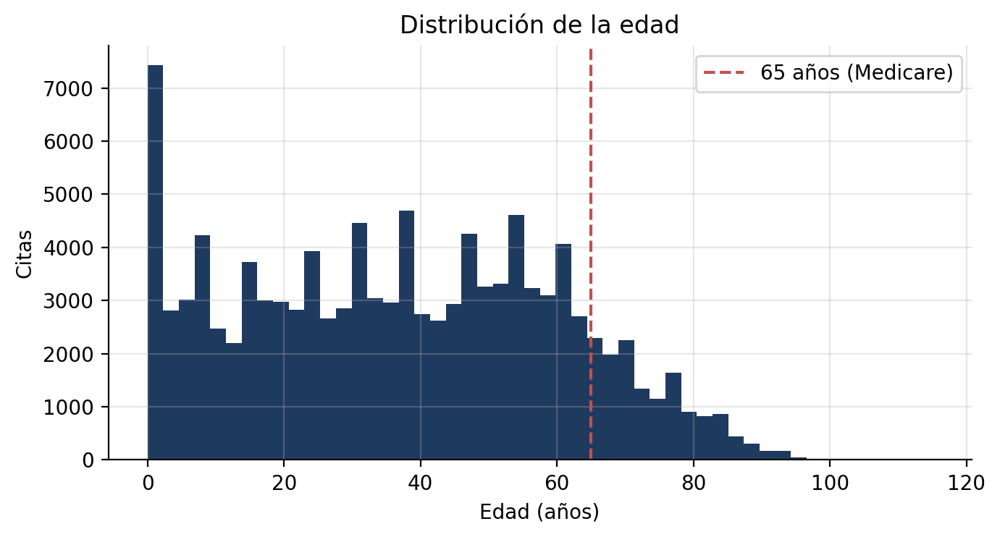
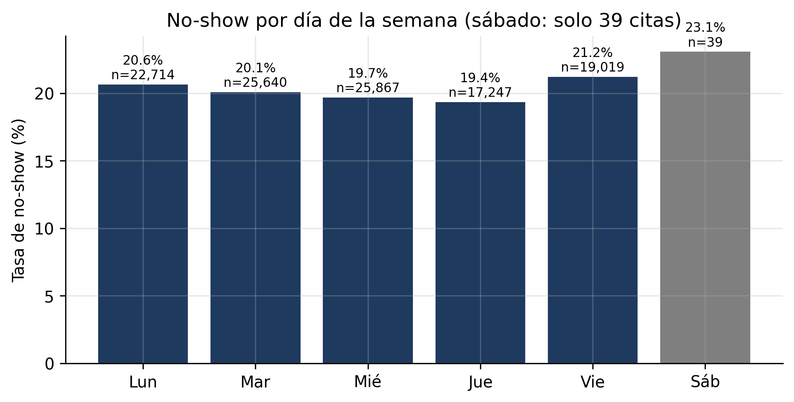
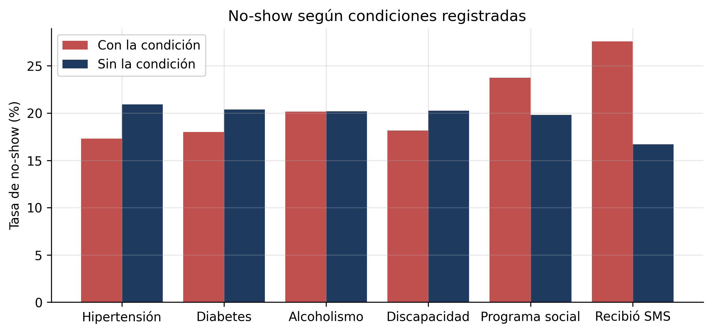
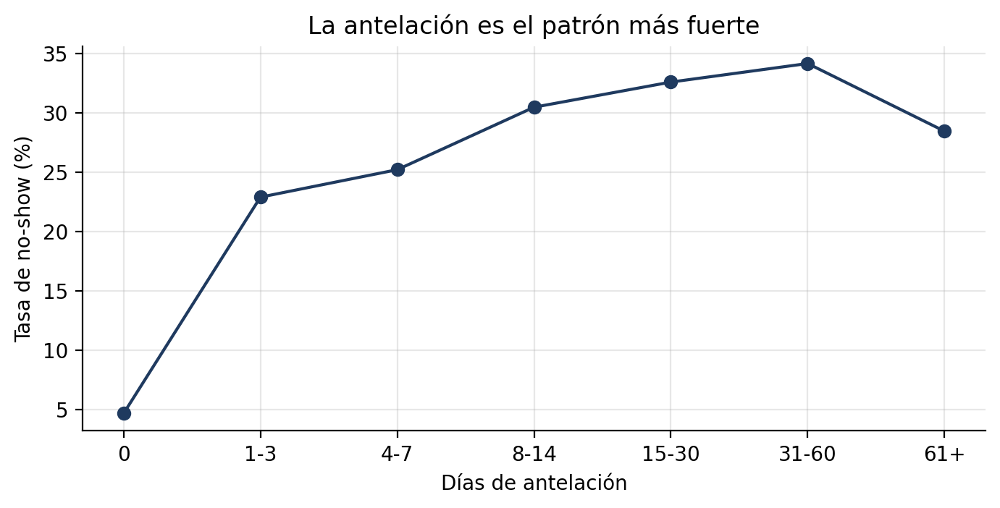
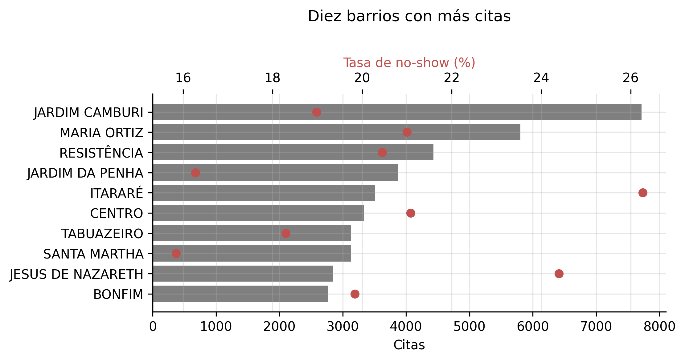
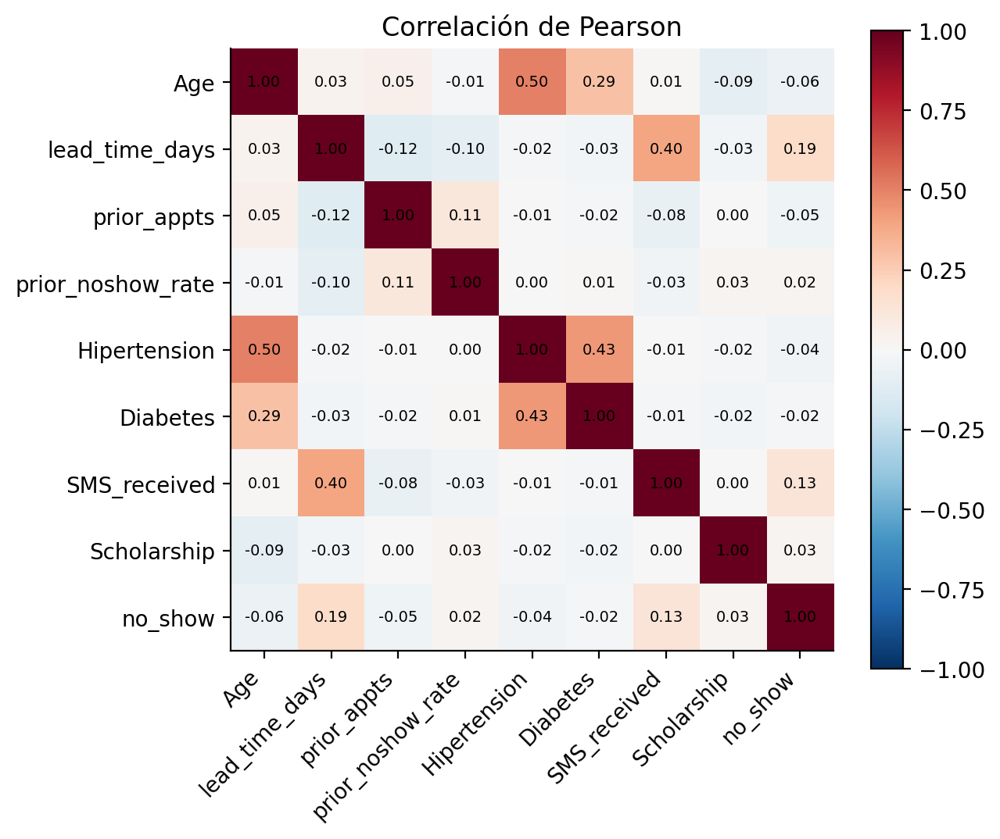
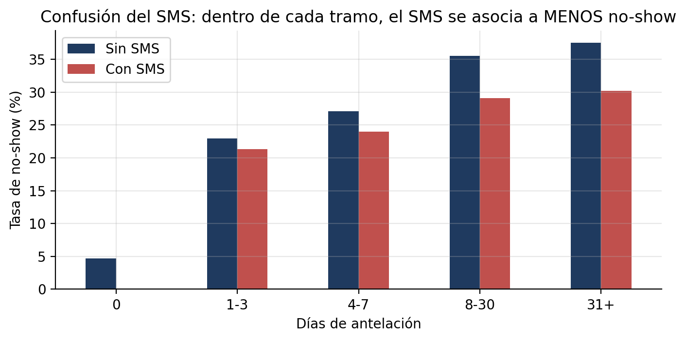
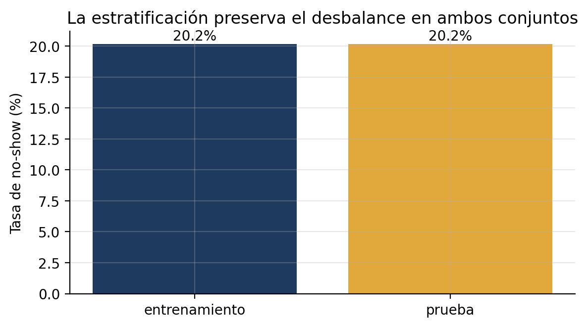

# Análisis exploratorio de datos

Notebook completo: [`notebooks/01_exploracion.ipynb`](../notebooks/01_exploracion.ipynb). Preparación: [`notebooks/02_preprocesamiento.ipynb`](../notebooks/02_preprocesamiento.ipynb).

## 1. Descripción del dataset

| Característica | Valor |
|---|---|
| Nombre | Medical Appointment No Shows (Hoppen, 2016) |
| Origen | Red pública de salud de Vitória, Brasil; citas con fecha de atención entre el 29/04/2016 y el 08/06/2016 |
| Registros | 110,527 citas de 62,299 pacientes (110,526 y 62,298 tras la limpieza) |
| Variables originales | 14: identificadores de paciente y cita, sexo, fecha de agendamiento, fecha de la cita, edad, barrio, programa social, hipertensión, diabetes, alcoholismo, discapacidad, SMS recibido y no-show |
| Variable objetivo | `no_show` (1 = no asistió). Prevalencia: **20.2%** |
| Licencia | CC BY-NC-SA 4.0 (ver [`data/README.md`](../data/README.md)) |

## 2. Calidad de datos

| Revisión | Resultado | Decisión |
|---|---|---|
| Valores faltantes | 0 | Ninguna |
| Citas duplicadas | 0 | Ninguna |
| Edad negativa | 1 registro | Eliminado (error de captura) |
| Edad mayor a 100 | 7 registros | Se conservan (plausibles; máximo 115) |
| Discapacidad con valores 2 a 4 | 199 registros | Se binariza (presencia de discapacidad) |
| Cita anterior a la fecha de agendamiento | 5 registros | Antelación llevada a 0 |
| Antelación | percentil 99 = 68 días, máximo 179 | Se conserva; el modelo de árboles es robusto a valores extremos |
| Citas por paciente | máximo 88 | Obliga a partir los datos **por paciente** |

## 3. Estadísticas descriptivas

| Variable | Valor |
|---|---|
| Edad media / mediana / desviación estándar | 37.1 / 37 / 23.1 años |
| Mujeres | 65.0% de las citas |
| Programa social (Bolsa Família) | 9.8% de las citas |
| Hipertensión / diabetes / alcoholismo / discapacidad | 19.7% / 7.2% / 3.0% / 2.0% |
| Recibió SMS | 32.1% |
| Barrios distintos | 81 |

## 4. Visualizaciones y patrones

**Edad.** Distribución amplia con muchas citas pediátricas. Solo 13% de las citas de prueba corresponde a personas de 65 años o más, el grupo más relevante para Medicare.

**Día de la semana.** Variación pequeña (19.4% a 21.2% de lunes a viernes). El sábado tiene solo 39 citas y no debe interpretarse.

**Condiciones clínicas.** Los pacientes con condiciones crónicas faltan **menos** (probablemente por un vínculo más frecuente con el sistema). El programa social se asocia a **más** inasistencia (23.7% frente a 19.8%).

**Antelación: el patrón más fuerte.** La inasistencia pasa de 4.7% en citas del mismo día a más de 30% con más de un mes de antelación.

**Barrio.** Entre los diez barrios con más citas, la tasa va de 15.8% (Santa Martha) a 26.3% (Itararé).

**Correlaciones.** Hipertensión y diabetes se correlacionan entre sí (0.43) y con la edad; la antelación es la variable numérica más correlacionada con el no-show (0.19) y también con el SMS (0.40).

**Confusión del SMS.** En bruto, quienes reciben SMS faltan más (27.6% frente a 16.7%). Dentro de cada tramo de antelación el patrón se invierte: el SMS se envía sobre todo a citas lejanas, que ya tienen más riesgo. Una regresión logística ajustada por antelación da una razón de momios de 0.77 (IC 95%: 0.75 a 0.80).

## 5. Decisiones de preprocesamiento

| Decisión | Justificación |
|---|---|
| Eliminar la edad negativa, binarizar la discapacidad, recortar antelaciones negativas | Errores de captura y consistencia de codificación |
| Variables derivadas: antelación, día de la semana, conteo de condiciones crónicas | Capturan los patrones del EDA |
| Historial (`prior_appts`, `prior_noshow_rate`) solo con citas **ya atendidas** al momento de agendar | Evita la fuga temporal: una cita agendada antes pero atendida después no puede aportar un desenlace aún desconocido |
| Frecuencia del barrio calculada **solo con entrenamiento** | Evita la fuga de información de la prueba |
| Partición 75/25 estratificada y agrupada por paciente | Un paciente con muchas citas no puede estar en ambos conjuntos; si estuviera, el desempeño se sobreestima |
| Sin escalado en el modelo final | Los árboles no lo necesitan; la regresión logística sí lo usa (pipeline con `StandardScaler`) |

## 6. Datos faltantes y desbalance

- **Faltantes:** no hay valores faltantes en el dataset. Los pacientes sin historial reciben 0 citas previas y tasa 0, codificación que los árboles distinguen sin problema.
- **Desbalance (20.2% positivos):** no se usa sobremuestreo ni ponderación de clases, porque distorsionan las probabilidades que el sistema usa para priorizar. Se usan métricas adecuadas (AUC-PR, Brier), un umbral de decisión elegido explícitamente para un recall de 70% y una comparación contra un clasificador sin información.
