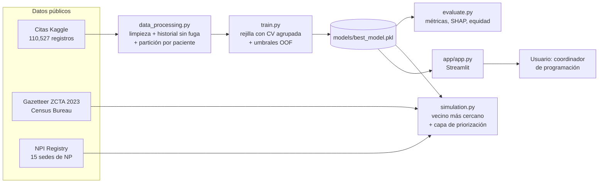

# Arquitectura del sistema y diseño del modelo

## 1. Modelo seleccionado y justificación

**Modelo final:** `HistGradientBoostingClassifier` de scikit-learn (Gradient Boosting basado en histogramas).

| Criterio | Justificación |
|---|---|
| Tipo de datos | Problema tabular de tamaño moderado (110,526 citas, 14 variables). En este escenario los ensambles de árboles igualan o superan a las redes neuronales profundas (James et al., 2021). |
| Desempeño | Mejor AUC en validación cruzada agrupada por paciente frente a regresión logística y Random Forest (0.736 frente a 0.734 del Random Forest ajustado). |
| No linealidad | Captura la relación no lineal con la antelación, que la regresión logística no logra (esta queda por debajo de un modelo que solo usa la antelación). |
| Probabilidades | Optimiza la pérdida logarítmica y produce probabilidades bien calibradas (Brier 0.142), necesarias para priorizar. |
| Explicabilidad | Compatible con SHAP TreeExplainer, que da explicaciones exactas y rápidas por predicción. |
| Costo | Entrena en segundos en CPU y cabe en un archivo de 0.3 MB, apto para despliegue gratuito. |

**Modelos comparados:** regresión logística (línea base interpretable), Random Forest (no lineal robusto) y Gradient Boosting (mayor capacidad), más una referencia que solo usa la antelación y un clasificador sin información.

## 2. Arquitectura detallada del modelo

| Hiperparámetro | Valor final | Cómo se eligió |
|---|---|---|
| `learning_rate` | 0.10 | Rejilla con CV agrupada; confirmado en el análisis de sensibilidad |
| `max_depth` | 5 | Ídem |
| `max_iter` (número de árboles) | 100 | Ídem |
| `min_samples_leaf` | 100 | Ídem |
| `max_leaf_nodes` | 31 (por defecto) | Explorado en el análisis de sensibilidad |
| `l2_regularization` | 0 (por defecto) | Explorado en el análisis de sensibilidad |
| `early_stopping` | desactivado | El número de árboles es un hiperparámetro explícito |
| Umbral global | 0.242 | Recall objetivo de 70% con predicciones fuera de muestra |
| Umbrales por grupo de edad | 0.283 / 0.306 / 0.239 / 0.189 / 0.182 | Mismo criterio dentro de cada grupo (mitigación de equidad) |

**Variables de entrada (14):** sexo, edad, programa social, hipertensión, diabetes, alcoholismo, discapacidad, recordatorio SMS, días de antelación, día de la semana, conteo de condiciones crónicas, citas previas ya resueltas, tasa previa de inasistencia y frecuencia del barrio. El diccionario completo está en [`data/README.md`](../data/README.md).

El objeto guardado (`models/best_model.pkl`) es una instancia de `ModeloRiesgo` (`src/model.py`) que encapsula el estimador, la lista de variables, el umbral global, los umbrales por grupo y los metadatos de entrenamiento.

## 3. Diagrama del sistema completo

## 4. Pipeline de datos: desde la entrada hasta la salida

**Entrenamiento**
1. `cargar_crudos` valida que el CSV tenga las 14 columnas esperadas.
2. `limpiar` elimina 1 edad negativa, recorta 5 antelaciones negativas a 0 y crea variables derivadas.
3. `agregar_historial` calcula citas previas y tasa previa de inasistencia usando solo citas cuya fecha de atención es anterior a la fecha de agendamiento (sin fuga temporal).
4. `particionar_por_paciente` separa 75% de entrenamiento y 25% de prueba sin pacientes compartidos; la frecuencia del barrio se calcula solo con entrenamiento.
5. `train.py` compara modelos, busca hiperparámetros con CV de 3 pliegues agrupada, calcula predicciones fuera de muestra (CV de 5 pliegues) y fija los umbrales.
6. `evaluate.py` mide todo en el conjunto de prueba, que no intervino en ninguna decisión.

**Inferencia (interfaz)**
1. El usuario ingresa una cita en el formulario o sube un CSV.
2. `validar_registro` / `validar_lote` verifican tipos, rangos y columnas; los errores se muestran en lenguaje claro.
3. `registro_a_features` arma la fila de 14 variables.
4. `ModeloRiesgo.predecir_probabilidad` devuelve la probabilidad; `umbrales_por_fila` aplica el umbral por grupo de edad (o el global).
5. SHAP explica la predicción individual; en lotes, `priorizar_lote` marca la fracción a confirmar primero por riesgo × distancia.
6. Los resultados se muestran con gráficos y se pueden descargar en CSV.

## 5. Motor de asignación y simulación

- **Asignación:** cada solicitud se asigna a la sede de NP más cercana (distancia de Haversine). Es una decisión de diseño deliberada: equivale a la lógica de las herramientas de asignación basadas en reglas geográficas.
- **Priorización:** se elige el 20% de las solicitudes para una confirmación proactiva, sin cambiar la asignación. Se comparan cinco políticas: al azar, solo distancia, por riesgo, riesgo × distancia y una cota óptima.
- **Datos:** 15 sedes (códigos postales con NP registrados en Ohio) y 300 solicitudes sorteadas entre los 1,233 códigos postales de Ohio. La asociación paciente-ubicación es **sintética**: en cada réplica se asigna a cada solicitud la cita de un paciente real del conjunto de prueba.

## 6. Tecnologías y versiones

| Componente | Librería | Versión |
|---|---|---|
| Lenguaje | Python | 3.12 |
| Datos | pandas / NumPy / SciPy | 3.0.2 / 2.4.4 / 1.17.1 |
| Modelado | scikit-learn | 1.8.0 |
| Estadística | statsmodels | 0.15.0 |
| Explicabilidad | SHAP | 0.52.0 |
| Visualización | Matplotlib / Plotly | 3.10.8 / 7.1.0 |
| Interfaz | Streamlit | 1.64.0 |
| Persistencia | joblib | 1.5.3 |
| Configuración | PyYAML | 6.0.3 |
| Pruebas | pytest | 9.1.1 |

## 7. Estructura del código

| Módulo | Responsabilidad |
|---|---|
| `src/utils.py` | Configuración (`config.yaml`), rutas relativas, logging, JSON, distancia de Haversine |
| `src/data_processing.py` | Carga, limpieza, historial, partición y validación de entradas |
| `src/model.py` | Fábricas de modelos y clase `ModeloRiesgo` (umbrales y serialización) |
| `src/train.py` | Entrenamiento completo: `python -m src.train` |
| `src/evaluate.py` | Evaluación completa: `python -m src.evaluate` |
| `src/diagnosis.py` | Diagnóstico de sobreajuste y subajuste (Semana 3): tracking por iteración, métricas cuantitativas, curvas de aprendizaje y de validación |
| `src/optimization.py` | Análisis de sensibilidad de hiperparámetros: `python -m src.optimization` |
| `src/simulation.py` | Escenario geográfico, políticas de priorización y simulación de Monte Carlo |
| `app/app.py` | Interfaz Streamlit (usa los módulos de `src/`, sin duplicar lógica) |
| `app/textos.py` | Textos de la interfaz en español e inglés |
