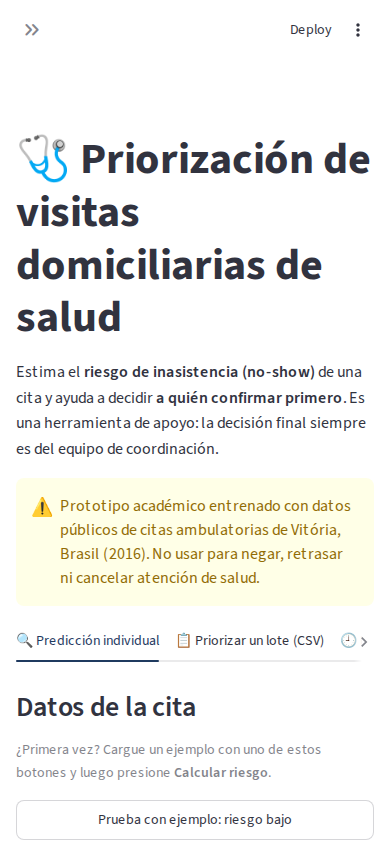
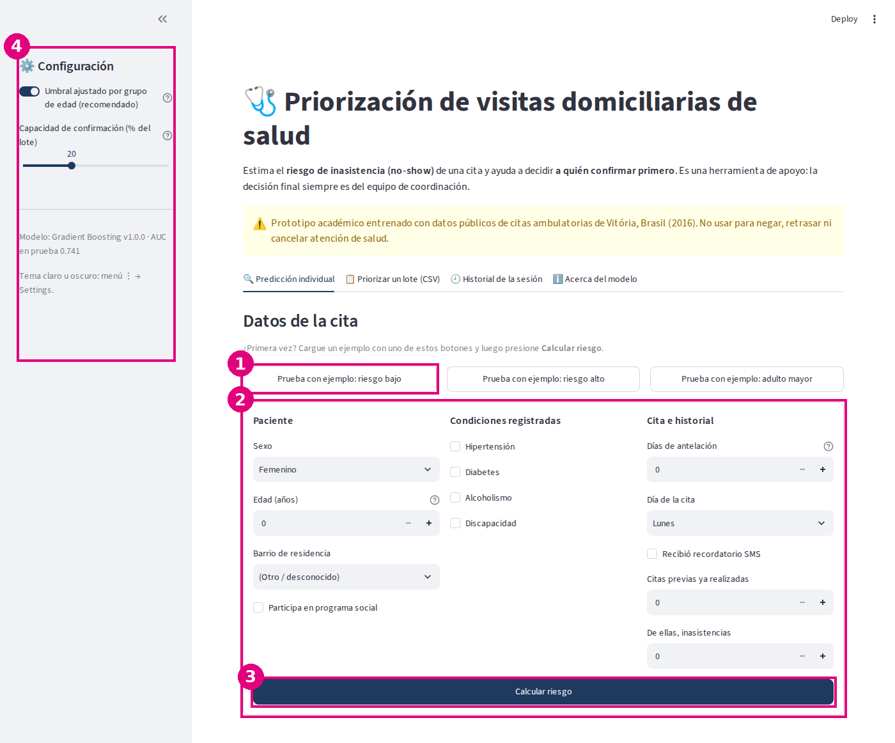
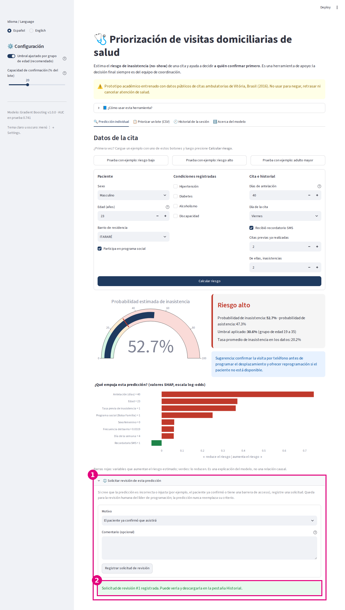
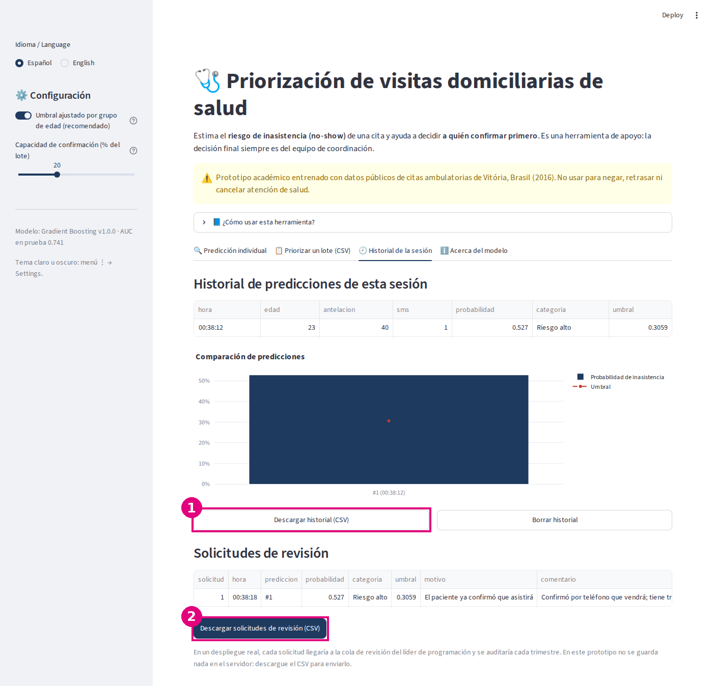
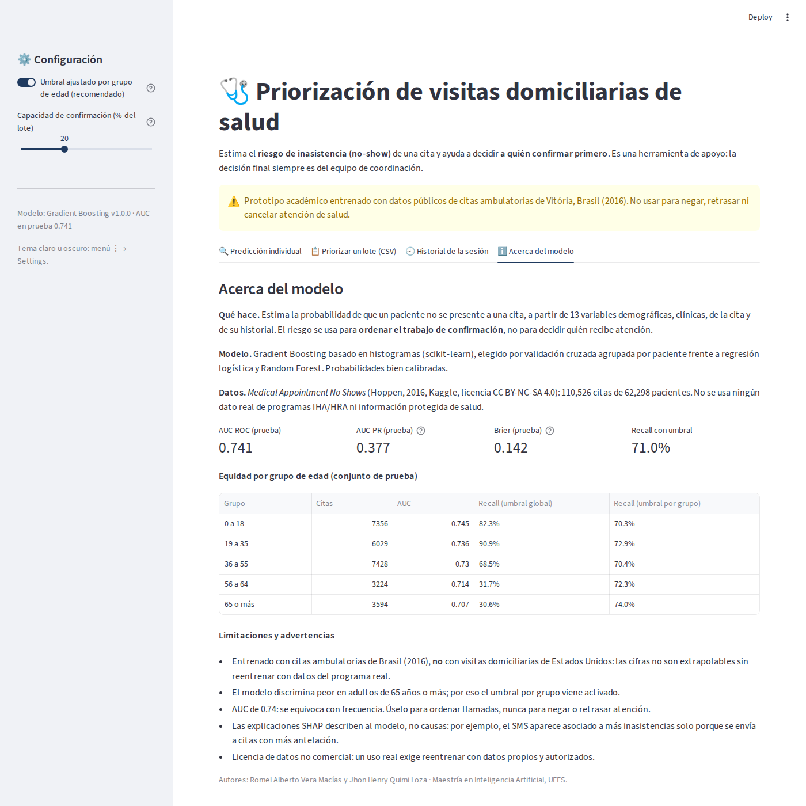
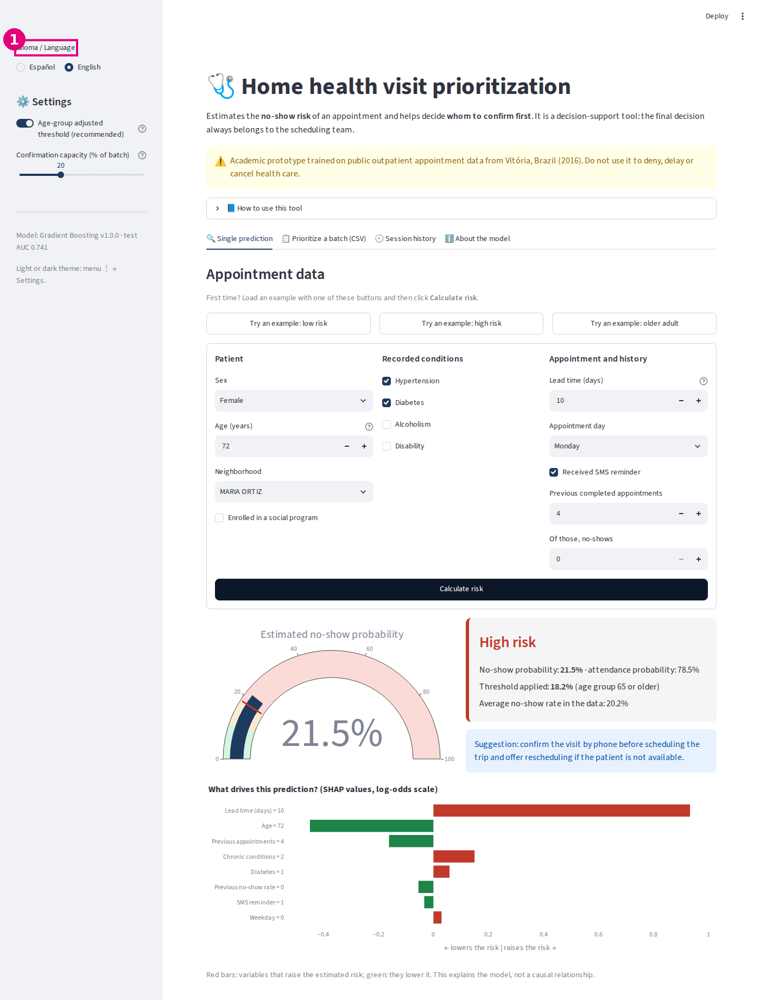
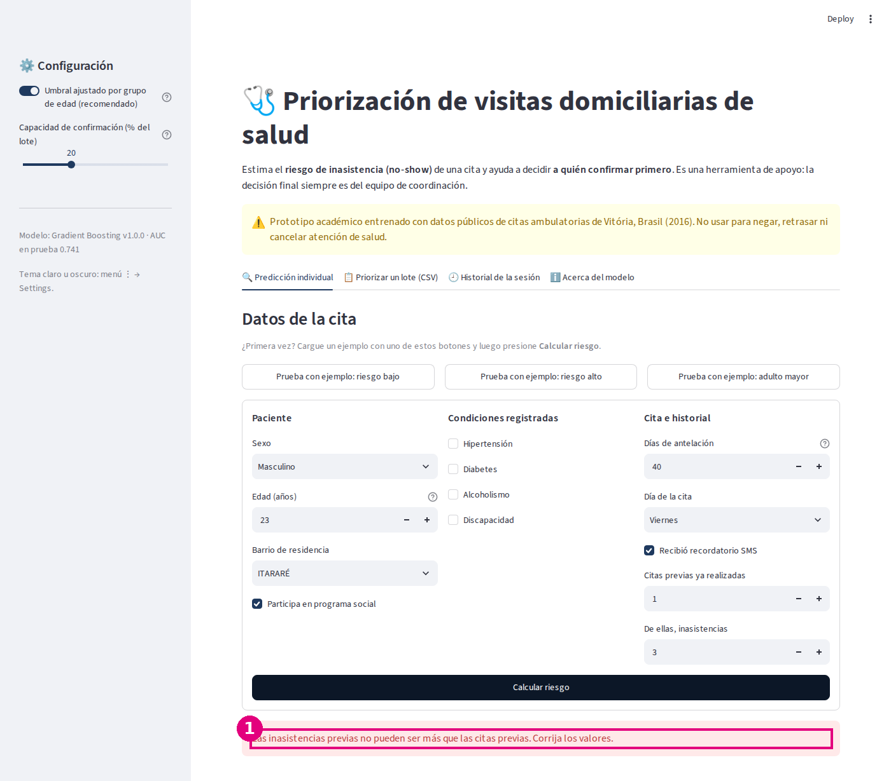

# Manual de usuario

Guía para usar la interfaz del **Sistema de Priorización de Visitas Domiciliarias**. No se requieren conocimientos técnicos.

## 1. Acceso

- **En línea:** abra el enlace de la aplicación publicado en el [README](../README.md#8-interfaz-de-usuario).
- **En su computadora:** desde la carpeta del proyecto ejecute `streamlit run app/app.py` y abra `http://localhost:8501`.

La aplicación funciona en computadoras y celulares, en **español o inglés** (selector *Idioma / Language* en la parte superior de la barra lateral). Dentro de la app, el desplegable **📘 ¿Cómo usar esta herramienta?** resume estos pasos, y los íconos ⓘ muestran ayudas.

## 2. Pantalla principal

| # | Elemento | Para qué sirve |
|---|---|---|
| 1 | Botones **Prueba con ejemplo** | Cargan automáticamente un paciente de ejemplo (riesgo bajo, riesgo alto o adulto mayor) |
| 2 | Formulario de la cita | Datos del paciente, condiciones registradas, fecha de la cita e historial |
| 3 | **Calcular riesgo** | Ejecuta la predicción |
| 4 | Barra lateral de configuración | Umbral por grupo de edad (recomendado) y capacidad de confirmación para lotes |
| 5 | Pestañas | Predicción individual, priorización de lotes, historial y "Acerca del modelo" |

## 3. Predicción individual paso a paso

1. Presione un botón **Prueba con ejemplo** o complete el formulario.
   - *Días de antelación:* días entre la fecha en que se agendó la cita y la fecha de la cita.
   - *Citas previas* e *inasistencias:* citas anteriores ya realizadas del paciente y cuántas de ellas fueron inasistencias.
2. Presione **Calcular riesgo**. Mientras procesa aparece un indicador de carga.
3. Lea el resultado:

| # | Elemento | Cómo interpretarlo |
|---|---|---|
| 1 | Indicador | Probabilidad estimada de inasistencia. La marca roja es el umbral aplicado. |
| 2 | Tarjeta de resultado | Categoría (bajo, moderado o alto), probabilidad de inasistencia y de asistencia, umbral usado (y grupo de edad) y tasa promedio de referencia (20.2%). |
| 3 | Sugerencia | Acción recomendada: confirmar por teléfono si el riesgo es alto. |
| 4 | Gráfico SHAP | Variables que más empujan el riesgo hacia arriba (rojo) o hacia abajo (verde) en **este** caso. |

**Categorías:** *alto* si la probabilidad supera el umbral; *moderado* si está entre el 60% del umbral y el umbral; *bajo* en otro caso.

**Solicitar revisión de una predicción.** Si cree que una predicción es incorrecta o injusta, abra **⚖️ Solicitar revisión de esta predicción** debajo del gráfico SHAP:

| # | Elemento | Cómo usarlo |
|---|---|---|
| 1 | Formulario de revisión | Elija el motivo (por ejemplo, *el paciente ya confirmó* o *tiene una barrera de acceso*) y, si quiere, un comentario **sin nombres ni datos que identifiquen al paciente**. Si elige *Otro*, el comentario es obligatorio. |
| 2 | Confirmación | La solicitud queda registrada como *pendiente de revisión humana*; puede verla y descargarla en la pestaña *Historial*. |

## 4. Priorizar un lote de visitas

1. **(1)** Descargue la plantilla CSV para ver el formato, o presione **Prueba con ejemplo: lote de 50 visitas**.
2. **(2)** Suba su archivo CSV. Columnas obligatorias: `gender_f`, `Age`, `Scholarship`, `Hipertension`, `Diabetes`, `Alcoholism`, `Handcap`, `SMS_received`, `lead_time_days`, `appt_dow` (0 = lunes), `prior_appts`, `prior_noshow_rate` (0 a 1), `neighbourhood_freq` (0 a 1). Opcionales: `id_visita` y `millas` (distancia a la sede del NP).
3. **(3)** Revise el resumen: visitas válidas, de riesgo alto y a confirmar primero.
4. **(4)** La tabla queda ordenada: primero las visitas marcadas con `confirmar_primero = 1`.
5. **(5)** Descargue los resultados en CSV.

Si el archivo incluye `millas`, el orden combina riesgo × distancia; si no, usa solo el riesgo. El porcentaje a confirmar se ajusta en la barra lateral (*Capacidad de confirmación*).

## 5. Historial y comparación

La pestaña **Historial de la sesión** guarda las predicciones individuales hechas mientras la página está abierta, las compara en un gráfico frente a su umbral y permite descargarlas en CSV o borrarlas **(1)**. Debajo aparece la tabla de **solicitudes de revisión**, que se descarga en CSV **(2)** para enviarla al responsable de revisarlas.

## 6. Acerca del modelo

Muestra qué hace el modelo, sus métricas en datos de prueba, la equidad por grupo de edad, por sexo y por indicadores socioeconómicos (programa social y barrio, con intervalos de confianza) y las limitaciones.

## 7. Cambiar el idioma

**(1)** En *Idioma / Language*, arriba en la barra lateral, elija *English*. Toda la interfaz, incluidos los ejemplos, las explicaciones SHAP y la sección "Acerca del modelo", cambia al inglés; los datos del formulario se conservan.

## 8. Solución de problemas

| Problema | Causa probable | Solución |
|---|---|---|
| "Las inasistencias previas no pueden ser más que las citas previas" | El número de inasistencias es mayor que el de citas | Corrija ambos valores |
| "Faltan columnas en el CSV" | El archivo no tiene todas las columnas obligatorias o tienen otro nombre | Descargue la plantilla y copie sus datos en ese formato |
| "Fila N: ... debe ser 0 o 1" | Una variable sí/no tiene otro valor | Use 1 para "sí" y 0 para "no" |
| "No se pudo leer el archivo" | El archivo no es CSV separado por comas | Guárdelo como CSV (UTF-8) desde Excel |
| "No se pudo cargar el modelo..." | Faltan archivos del modelo en una instalación local | Ejecute `python -m src.train` y `python -m src.evaluate` |
| "Si elige «Otro», explique el motivo en el comentario" | Se eligió el motivo *Otro* sin comentario | Escriba brevemente el motivo |
| La app tarda en abrir | Primera carga del modelo en el servidor gratuito | Espere unos segundos; las siguientes consultas son inmediatas |

## 9. Preguntas frecuentes

**¿La aplicación guarda los datos que ingreso?** No. Todo se procesa en memoria y se borra al cerrar la página.

**¿Qué pasa si no estoy de acuerdo con una predicción?** Usted decide siempre. Además, puede registrar una **solicitud de revisión** con el motivo; en un despliegue real llegaría al líder de programación, que la revisa y la incluye en la auditoría trimestral.

**¿Puedo usarla con pacientes reales?** No. Es un prototipo académico entrenado con datos públicos de otro país y otro tipo de cita. Un uso real exige reentrenarlo con datos autorizados y validarlo.

**¿Qué significa el umbral por grupo de edad?** Con un solo umbral, el sistema detectaba solo el 31% de las inasistencias de los adultos mayores. El umbral por grupo acerca la cobertura de todos los grupos (entre 70% y 74%), aunque no la vuelve idéntica. Se puede desactivar en la barra lateral para comparar.

**¿Por qué el SMS aparece aumentando el riesgo?** Porque en los datos el SMS se enviaba sobre todo a citas agendadas con mucha antelación, que ya tienen más riesgo. El modelo refleja esa asociación; no significa que el recordatorio cause inasistencias.

**¿Qué tan preciso es?** AUC de 0.741 en datos no vistos: ordena bien a los pacientes por riesgo en tres de cada cuatro comparaciones, pero se equivoca con frecuencia en casos individuales.

**¿Puedo cambiar de tema claro a oscuro?** Sí: menú ⋮ (arriba a la derecha) → *Settings* → *Theme*.

**¿Puedo usarla en inglés?** Sí: seleccione *English* en *Idioma / Language*, arriba en la barra lateral. Los datos ingresados se conservan al cambiar de idioma.

## 10. Soporte

Abra un *issue* en el repositorio de GitHub del proyecto (pestaña **Issues**) describiendo el problema, los pasos para reproducirlo y, si es posible, una captura de pantalla. Autores: Romel Alberto Vera Macías y Jhon Henry Quimi Loza.
