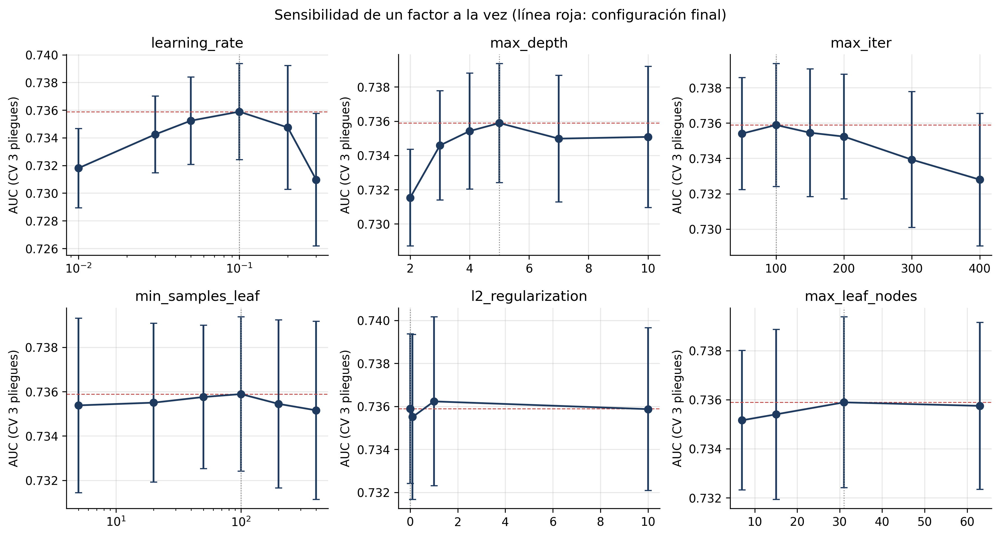
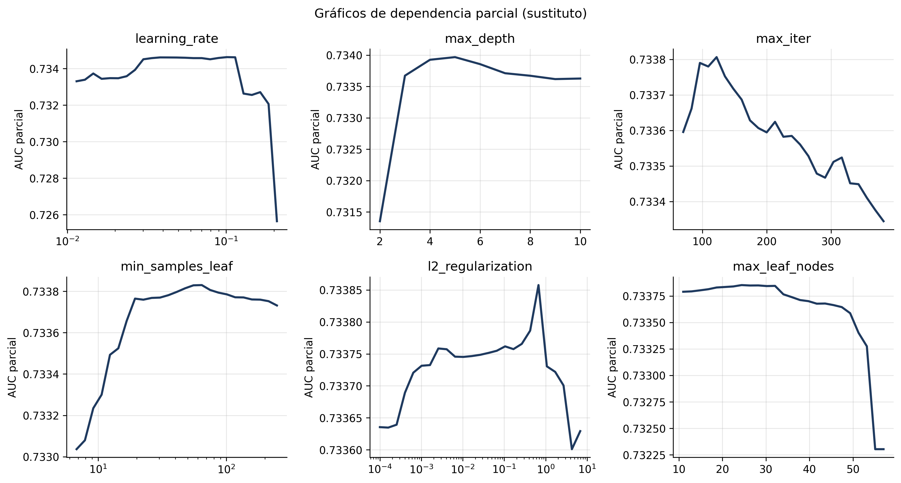
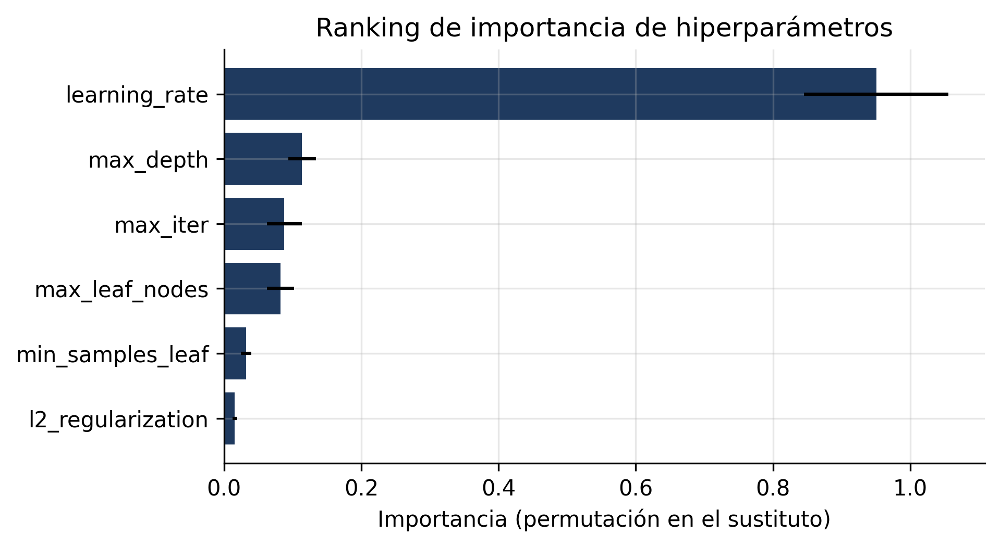
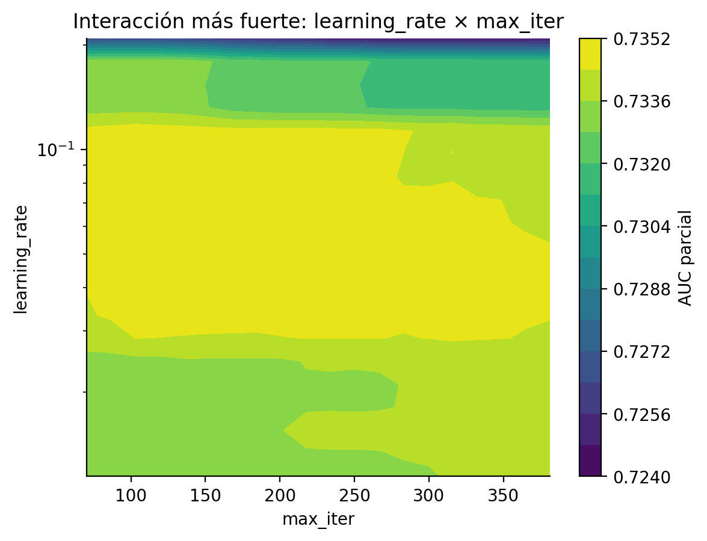
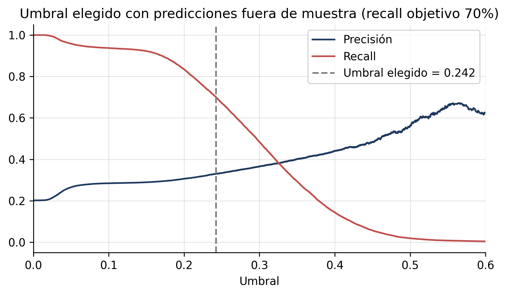

# Optimización de hiperparámetros (Workshop S5)

Notebook: [`notebooks/04_optimizacion.ipynb`](../notebooks/04_optimizacion.ipynb). Código: [`src/optimization.py`](../src/optimization.py). Resultados crudos: [`results/metrics/sensibilidad_hiperparametros.csv`](../results/metrics/sensibilidad_hiperparametros.csv).

**Regla de oro:** toda la optimización usa **validación cruzada estratificada y agrupada por paciente sobre el conjunto de entrenamiento**. El conjunto de prueba solo se usa en la comparación final.

## 1. Proceso

| Etapa | Qué se hizo | Configuraciones |
|---|---|---|
| 1. Selección del modelo | Rejilla para Gradient Boosting y Random Forest (CV de 3 pliegues) | 16 + 6 |
| 2. Sensibilidad de un factor a la vez | Variar cada hiperparámetro alrededor de la configuración elegida | 28 (incluida la base) |
| 3. Búsqueda aleatoria amplia | Muestreo en todo el espacio (escala logarítmica para tasa, hoja y L2) | 40 |
| 4. Modelo sustituto | Random Forest que aprende configuración → AUC (R² = 0.81) para el ranking, la dependencia parcial y las interacciones | 68 puntos |
| 5. Umbral de decisión | Predicciones fuera de muestra (CV de 5 pliegues) con recall objetivo de 70% | |
| 6. Calibración | Verificación con curva de confiabilidad y puntaje de Brier | |

## 2. Hiperparámetros explorados y rangos

| Hiperparámetro | Rango (búsqueda aleatoria) | Niveles de un factor | Valor final |
|---|---|---|---|
| `learning_rate` | 0.01 a 0.3 (log) | 0.01, 0.03, 0.05, **0.10**, 0.2, 0.3 | 0.10 |
| `max_depth` | 2 a 10 | 2, 3, 4, **5**, 7, 10 | 5 |
| `max_iter` | 50 a 400 | 50, **100**, 150, 200, 300, 400 | 100 |
| `min_samples_leaf` | 5 a 400 (log) | 5, 20, 50, **100**, 200, 400 | 100 |
| `l2_regularization` | 0.0001 a 10 (log) | **0**, 0.001, 0.1, 1, 10 | 0 |
| `max_leaf_nodes` | 7 a 63 | 7, 15, **31**, 63 | 31 |

## 3. Resultados del análisis de sensibilidad

Las 68 configuraciones obtienen un AUC de validación cruzada entre 0.714 y 0.736 (mediana 0.735). El desempeño forma una **meseta amplia**: la mayoría de las configuraciones razonables quedan a menos de 0.002 del máximo.

| Hiperparámetro | Rango de AUC al variarlo solo | Lectura |
|---|---|---|
| `learning_rate` | 0.0049 | El más sensible: muy bajo (0.01) no alcanza a aprender en 100 árboles; muy alto (0.3) sobreajusta |
| `max_depth` | 0.0044 | Profundidad 2 subajusta; de 4 en adelante es casi plano |
| `max_iter` | 0.0031 | Más de 200 árboles empeora ligeramente (sobreajuste por iteraciones) |
| `min_samples_leaf`, `max_leaf_nodes`, `l2_regularization` | 0.0007 cada uno | Prácticamente indiferentes en sus rangos |

## 4. Dependencia parcial

Observe las escalas: solo `learning_rate` y `max_depth` mueven el AUC parcial en más de 0.001. La tasa de aprendizaje tiene una zona óptima entre 0.03 y 0.12 y cae bruscamente sobre 0.2; la profundidad mejora hasta 4 o 5 y luego se estabiliza; el número de árboles tiene su mejor zona entre 90 y 130.

## 5. Ranking de importancia de hiperparámetros

| Posición | Hiperparámetro | Importancia (permutación en el sustituto) |
|---|---|---|
| 1 | `learning_rate` | 0.951 |
| 2 | `max_depth` | 0.114 |
| 3 | `max_iter` | 0.088 |
| 4 | `max_leaf_nodes` | 0.082 |
| 5 | `min_samples_leaf` | 0.032 |
| 6 | `l2_regularization` | 0.016 |

La tasa de aprendizaje concentra la mayor parte del efecto. El ranking coincide con el de la sensibilidad de un factor a la vez en las tres primeras posiciones.

## 6. Análisis de interacciones

Estadístico H de Friedman sobre el sustituto (0 = efectos aditivos):

| Par | H |
|---|---|
| `learning_rate` × `max_iter` | 0.135 |
| `learning_rate` × `max_depth` | 0.123 |
| `max_depth` × `max_leaf_nodes` | 0.070 |
| `max_depth` × `max_iter` | 0.067 |

La interacción más fuerte es la esperada en boosting: **tasa de aprendizaje × número de árboles**. Con una tasa baja hacen falta muchos más árboles, y con una tasa alta, muchos árboles sobreajustan. Por eso ambos deben ajustarse juntos y no por separado.

## 7. Configuración final y justificación

**Final:** `learning_rate=0.1`, `max_depth=5`, `max_iter=100`, `min_samples_leaf=100` (CV AUC 0.7359).

La mejor configuración de toda la búsqueda solo cambia `l2_regularization` a 1.0 y logra 0.7362: una diferencia de **0.0003**, diez veces menor que la desviación estándar entre pliegues (0.003). No se cambia la configuración porque:
1. La mejora no es distinguible del ruido de la validación cruzada.
2. La configuración final está en el centro de la meseta, lejos de las zonas de caída (tasa > 0.2, profundidad 2, más de 300 árboles), lo que la hace robusta.
3. Mantenerla conserva la trazabilidad con el informe escrito.

**Hallazgo principal:** el desempeño está limitado por la información de las variables, no por los hiperparámetros.

## 8. Umbral de decisión y calibración

Con el umbral por defecto de 0.5 el modelo detecta solo el 1.7% de las inasistencias, porque pocas citas superan el 50% de probabilidad (la prevalencia es 20%). El umbral de **0.242**, elegido con predicciones fuera de muestra para un recall de 70%, detecta el 71.0% en prueba. Las probabilidades están bien calibradas (Brier 0.142 frente a 0.161 sin información; brecha media por decil 0.006), por lo que no se aplicó recalibración.

## 9. Comparación antes y después (conjunto de prueba)

| Modelo | AUC-ROC | AUC-PR | Brier | Umbral | Recall | Precisión |
|---|---|---|---|---|---|---|
| v1: valores por defecto, umbral 0.5 | 0.740 | 0.376 | 0.143 | 0.500 | 0.022 | 0.573 |
| **Final: rejilla + umbral fuera de muestra** | **0.741** | **0.377** | **0.142** | **0.242** | **0.710** | **0.334** |

La optimización de hiperparámetros aporta poco al AUC (+0.002), coherente con la meseta observada. La mejora operativa grande viene del **umbral**: el recall pasa de 2% a 71%. A esto se suma la mitigación de equidad (umbrales por grupo de edad), descrita en [`consideraciones_eticas.md`](consideraciones_eticas.md).
